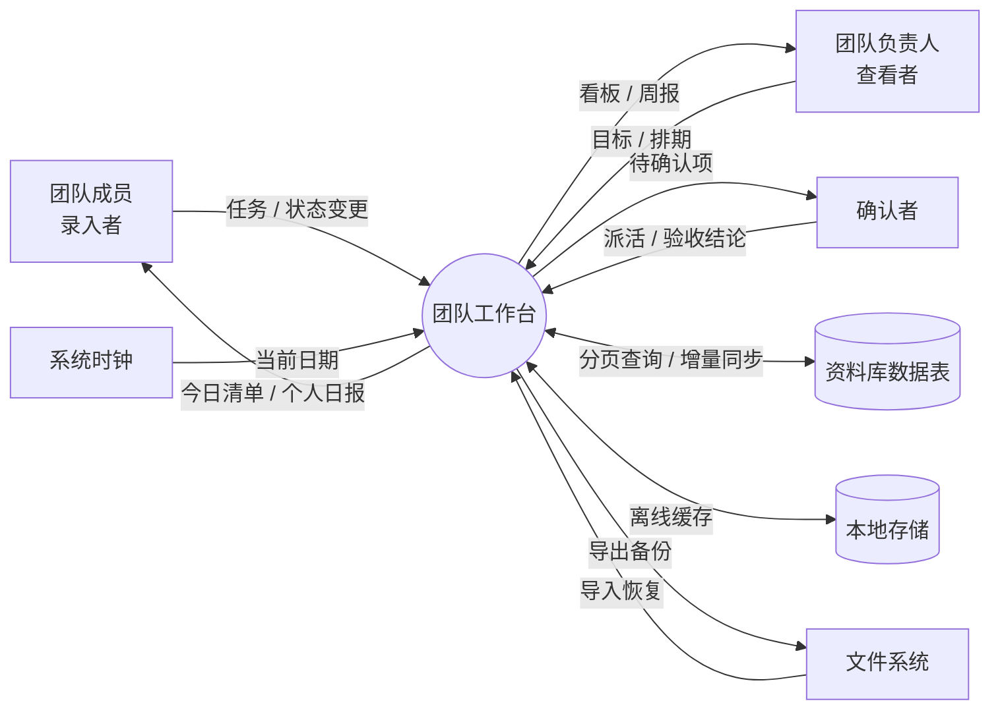

# 团队工作台 · 系统需求分析（数据流分析）

> 课程来源：《信息系统分析与设计》数字教材 第 3 章「系统需求分析」（幻灯片 36/102，启发问题：数据流分析）
> 分析对象：本会话前两轮讨论确定的「团队工作台」
> 文档内容：① 启发问题原文转录 ② 逐题答案（结合具体系统） ③ 前序「需求梳理」讨论内容整合 ④ 前序「性能设计」讨论内容整合
> 说明：若课程另有指定系统，本文的分析框架、表格与检查判据可原样套用，只需替换案例数据。

---

## 第一部分 启发问题原文（图片转录）

**启发问题：数据流分析，需要回答以下问题：**

1. 系统作为信息处理器主要完成什么功能？最重要的输入和输出数据是什么？
2. 系统作为一个整体，和外界环境存在什么关系？
3. 系统功能复杂，是否能够分解为几个相对独立的又有联系的子系统或子功能？
4. 分解后的子功能是否仍然很复杂，还可以划分为更细更具体的子功能吗？
5. 每个功能或子功能的输入数据和输出数据是什么？
6. 系统中需要长期保存的数据有哪些？例如各种表格、单据、文件，这些数据如何创建、修改和使用？
7. 在一个业务流程中，数据来源到最后去处是否完整？

---

## 第二部分 逐题答案

### 题 1：系统作为信息处理器主要完成什么功能？最重要的输入和输出数据是什么？

**核心功能（一句话）**：把团队成员分散产生的原始事件（新增任务、状态变更、阻塞上报、业务记录），转换为「今天该做什么」和「这段时间做成了什么」两类可执行、可追溯的信息。

从信息处理器（IPO）角度看，它完成的是一个 **采集 → 规范化 → 存储 → 按规则聚合 → 分发呈现** 的闭环：

| 环节 | 内容 |
| --- | --- |
| 输入 (I) | 成员提交的任务与记录、状态变更事件、基础配置、系统时钟 |
| 处理 (P) | 校验与日期归一化、按状态/截止日过滤、逾期识别与自动顺延、按负责人与周期聚合、生成统计与格式化文本 |
| 输出 (O) | 「今天要处理」清单、进度与统计视图、周报文本、历史查询结果、备份文件 |

**最重要的输入数据**

| 输入数据 | 来源 | 说明 |
| --- | --- | --- |
| 任务数据 | 团队成员录入 | 标题、负责人、截止日、优先级、状态、原始截止日、创建/更新时间 |
| 状态变更事件 | 成员勾选 / 确认者验收 | 完成、延期、阻塞、重新打开；是驱动全系统的数据流 |
| 业务记录 | 各模块录入 | 周报条目、打卡、账目等，随首期模块而定 |
| 基础配置 | 确认者维护 | 成员名单、分类标签、目标值/预算 |
| 时间信号 | 系统时钟（隐式外部实体） | 触发逾期判定、每日顺延、每周汇总 |

**最重要的输出数据**

| 输出数据 | 去向 | 说明 |
| --- | --- | --- |
| 「今天要处理」清单 | 录入者、查看者 | 逾期 + 今日 + 临期，逾期标红且可一键处理，是首屏最高价值输出 |
| 周报 / 汇总文本 | 查看者、负责人 | 由本周完成项自动汇总，减少重复录入 |
| 统计视图 | 查看者 | 完成率、分类分布、趋势（内联 SVG 图表） |
| 历史查询结果 | 全员 | 对账、追溯「谁在什么时候改了状态」 |
| JSON / CSV 备份 | 文件系统 | 迁移与灾备 |

> 判断「最重要」的标准：去掉后系统是否还有存在意义。去掉图表仍可用，去掉「今天要处理」和状态变更流，系统就退化成一个普通表格。

---

### 题 2：系统作为一个整体，和外界环境存在什么关系？

即画 **0 层数据流图（上下文图）**：一个加工（团队工作台）+ 若干外部实体 + 流入流出的数据流。

| 外部实体 | 与系统的关系 | 流入系统的数据 | 流出系统的数据 |
| --- | --- | --- | --- |
| 团队成员（录入者） | 主要数据生产者 | 任务、记录、状态变更 | 今日清单、录入后的即时回报（自动生成的个人日报） |
| 团队负责人（查看者） | 主要数据消费者 | 目标值、排期调整 | 看板、周报、统计视图 |
| 确认者 | 规则与状态把关者 | 派活、验收结论、配置修改 | 待确认项列表 |
| 边缘参与者 | 只读、偶尔被 @ | 几乎无 | 被分享的视图 |
| 系统时钟 | 时间触发源 | 当前日期、周期边界 | 无（驱动内部处理） |
| 资料库数据表 / 云存储 | 持久化服务 | 同步回传的记录、增量数据 | 分页查询请求、写入请求 |
| 浏览器本地存储 | 离线缓存层 | 缓存记录 | 离线期间的暂存数据 |
| 本地文件系统 | 备份通道 | 导入的 JSON / CSV | 导出的备份文件 |



**系统边界（明确不做什么，同样是需求分析结论）**

- 不做账号体系与组织权限：靠共享链接访问，拿到链接即可打开，因此**不预填真实隐私数据**。
- 不做正式审批流引擎：状态确认由「确认者」在页面内完成，不是工作流系统。
- 不发浏览器通知 / 系统推送：以「打开就看见」的置顶区域替代提醒。
- 不做大文件与视频存储。

**四类关系归纳**：数据流入（录入与配置）、数据流出（清单与报表）、约束（时间驱动逾期与周周期）、依赖（云存储与本地缓存双写，连接失败自动降级为离线模式）。

---

### 题 3：系统功能复杂，是否能够分解为几个相对独立的又有联系的子系统或子功能？

**可以，而且必须分解。** 按「数据流 + 单一职责」划分为 4 个首期子功能（遵循前序结论：首期不超过 3–4 个模块）：

| 编号 | 子功能 | 主要职责 | 输入 | 输出 |
| --- | --- | --- | --- | --- |
| F1 | 任务采集与状态维护 | 新建、编辑、勾选完成、阻塞上报、验收确认 | 录入表单、状态事件 | 规范化后的任务记录，写入 D1 |
| F2 | 今日待办生成与逾期顺延 | 按日期与状态筛选、排序、置顶渲染 | D1 任务记录、系统日期 | 「今天要处理」清单 |
| F3 | 汇总统计与周报生成 | 按周期/负责人聚合，生成文本与图表 | D1、D2 记录、周期参数 | 周报文本、统计视图 |
| F4 | 数据存储与同步 | 分 key 读写、节流落盘、增量同步、备份 | 各功能的数据变更 | 持久化数据、备份文件 |

**「相对独立」体现在**：四个子功能之间没有直接的函数调用关系，全部通过共享数据存储 D1/D2 交换数据，由唯一的 `refreshAll()` 统一调度刷新。这样 F2 的规则改动不会波及 F3 的统计口径。

**「又有联系」体现在**：F1 写 D1 → F2 读 D1 生成清单 → 用户点击产生新的状态事件 → 回到 F1 写 D1 → F3 读 D1 汇总。整个系统是一条由「任务记录」贯穿的闭环数据流。

> 架构约束（前序讨论结论）：调用关系必须构成**有向无环图**。严禁 `renderCalendar()` 与 `renderTodayList()` 一类渲染函数互相调用，否则轻则一次点击多次重绘，重则栈溢出。

---

### 题 4：分解后的子功能是否仍然很复杂，还可以划分为更细更具体的子功能吗？

F1、F3、F4 已足够简单，**F2 仍然复杂，需要二级分解**——它集中了日期边界、状态判断和业务规则，是缺陷高发区：

| 二级编号 | 子子功能 | 输入 | 处理规则 | 输出 |
| --- | --- | --- | --- | --- |
| F2.1 | 日期归一化 | 各类日期输入 | 统一为 `YYYY-MM-DD` 字符串，`today` 只计算一次 | 规范日期 |
| F2.2 | 逾期识别 | 任务记录、today | `due < today` 且状态非完成/取消 | 逾期项集合（标红） |
| F2.3 | 自动顺延 | 昨日未完成项 | 滚入今天，**保留原始截止日**用于标注，不允许凭空消失 | 顺延后的今日项 |
| F2.4 | 临期筛选 | 任务记录、today | `today ≤ due ≤ today+2` | 临期项集合 |
| F2.5 | 排序与置顶渲染 | 上述集合 | 逾期 > 今日 > 临期，同级按优先级 P0/P1/P2 | 首屏清单（限量 50 条） |

F4 也可再分一层：F4.1 分 key 读写、F4.2 节流落盘与 `pagehide` 强制 flush、F4.3 离线缓存与按时间戳的冲突合并、F4.4 JSON 导出 / 导入恢复。

**分解停止判据**（回答「还可以再分吗」的标准）：

1. 每个叶子功能能用一句「输入 → 处理规则 → 输出」说清楚；
2. 规则是业务规则，而不是代码实现细节（再往下拆就是详细设计，不属于需求分析的层次）；
3. 叶子功能有且仅有一个变更理由；
4. 父图与子图的输入输出保持平衡（父图一条数据流，子图不能凭空多出外部实体）。

---

### 题 5：每个功能或子功能的输入数据和输出数据是什么？

汇总为**功能级数据流表**（数据字典的雏形）：

| 功能 | 输入数据 | 处理要点 | 输出数据 | 输出去向 |
| --- | --- | --- | --- | --- |
| F1 采集与状态维护 | 任务表单、状态事件、验收结论 | 校验必填项、补 id 与时间戳、记录 `originalDue` | 任务记录、变更日志 | D1、F2、F4 |
| F2.1 日期归一化 | 原始日期、系统日期 | 统一格式、跨月跨年边界校验 | `YYYY-MM-DD` 日期 | F2.2–F2.5 |
| F2.2 逾期识别 | 任务记录、today | 未完成且 `due < today` | 逾期项 + 红色标记 | F2.5 |
| F2.3 自动顺延 | 昨日未完成项 | 滚入今日、保留原始截止日 | 顺延后的今日项 | F2.5、D1 |
| F2.4 临期筛选 | 任务记录、today | 未来 2 日内到期 | 临期项 | F2.5 |
| F2.5 排序渲染 | 三类集合 | 逾期 > 今日 > 临期，同级按优先级 | 首屏清单（≤50 条） | 用户界面、F1（点击事件回流） |
| F3 汇总统计 | D1、D2 记录、周期参数 | 按周/人聚合，缓存统计结果 | 周报文本、完成率、图表数据 | 查看者、D2、文件系统 |
| F4 存储同步 | 各功能变更、同步回传数据 | 分 key、300ms 节流、增量合并、冲突按时间戳 | 持久化数据、同步状态、备份文件 | 数据表、本地存储、文件系统 |

**关键数据项定义（节选）**

| 数据项 | 类型 / 取值 | 含义 |
| --- | --- | --- |
| `id` | 字符串 | 任务唯一标识，用于事件委托的 `data-id` 与 `id → index` 映射 |
| `due` | `YYYY-MM-DD` | 当前截止日，字典序即时间序 |
| `originalDue` | `YYYY-MM-DD` | 首次设定的截止日，顺延后不改，用于显示「已逾期 N 天」 |
| `status` | 待办 / 进行中 / 待确认 / 完成 / 取消 | 状态机取值，`完成` 是否需第二人确认由配置决定 |
| `priority` | P0 / P1 / P2 | 同级排序依据 |
| `updatedAt` | 时间戳 | 增量同步与冲突合并依据 |

> 注意 `due` 与 `originalDue` 分开保存是本题的易漏点：只存一个字段，顺延后就无法追溯原始承诺日期。

---

### 题 6：系统中需要长期保存的数据有哪些？这些数据如何创建、修改和使用？

**长期保存的数据存储（DFD 中的 D1–D4）**

| 存储 | 内容 | 主要字段 | 生命周期 |
| --- | --- | --- | --- |
| D1 任务表 | 全部任务及其状态 | id, title, owner, due, originalDue, priority, status, createdAt, updatedAt | 长期，完成后归档而非删除 |
| D2 业务记录表 | 周报条目、打卡、账目等 | id, module, date, content, amount, owner | 长期，按月分区 |
| D3 配置表 | 成员、分类、目标值、示例数据标记 | key, value, updatedBy | 长期，随团队调整 |
| D4 同步元数据 | 最后同步时间、脏标记、版本号 | lastSyncAt, dirty, version | 运行期长期存在 |

**创建 / 修改 / 使用（CRUD 矩阵）**

| 数据实体 | 创建 (C) | 读取 (R) | 修改 (U) | 删除 (D) |
| --- | --- | --- | --- | --- |
| D1 任务 | 录入者新建、确认者派活 | F2、F3、全员查询 | 负责人改内容；确认者改状态；**完成是否需二次确认由规则定** | 仅确认者可清空，且需二次确认弹窗 |
| D2 业务记录 | 各模块录入者 | F3 汇总、历史查询 | 创建者本人 | 清空示例数据按钮 / 确认者 |
| D3 配置 | 确认者 | 全部功能 | 仅确认者 | 重置为默认 |
| D4 同步元数据 | 系统自动 | F4 | 系统自动（每次同步） | 不删除 |

**存储方案与数据一致性**

- **在线层**：资料库数据表，表名 `workspace_团队工作台`，支持分页查询、条件过滤、按 `updatedAt` 增量同步；页面右上角显示同步状态（已同步 / 同步中 / 离线模式）。
- **离线层**：`localStorage` 作缓存，key 前缀统一 `wb_{工作台标识}_`，按「模块 + 月份」拆分（如 `wb_xx_tasks_2026-11`），单 key ≤ 500KB；断网时暂存操作，恢复后批量同步；冲突以最新时间戳为准，合并时保留双方新增内容。
- **备份层**：首屏提供「导出 JSON」「导入恢复」，导入不设条数上限；记账类另提供 CSV 导出；数据积累到 30 条时温和提示导出备份。
- **即时回报设计**（保证录入动力）：录入者勾完任务即自动生成他的个人日报，避免「录入者不是受益者」导致系统荒废。

> 团队场景额外三问（个人工作台没有的）：**数据归属**（成员离职/换岗后记录归谁）、**可见范围**（谁能看谁能改；共享链接模式不提供真实权限隔离）、**确认权**（谁有资格把状态改成「完成」）。

---

### 题 7：在一个业务流程中，数据来源到最后去处是否完整？

选取主流程 **「任务从创建到周报归档」** 做端到端追踪：

| 步骤 | 数据来源 | 处理 | 涉及存储 | 数据去处 |
| --- | --- | --- | --- | --- |
| 1 | 成员录入 / 确认者派活 | F1 校验、补 id 与时间戳 | 写入 D1 | 任务记录 |
| 2 | 系统时钟（每日） | F2.1–F2.5 筛选、顺延、排序 | 读 D1 | 首屏「今天要处理」 |
| 3 | 成员看到清单并点击 | F1 状态变更事件 | 读 + 写 D1 | 新状态、变更日志 |
| 4 | 状态为「待确认」时 | 确认者验收 | 写 D1 | 终态「完成」 |
| 5 | 周期边界（每周） | F3 按周/人聚合 | 读 D1、D2 | 周报文本、统计视图 |
| 6 | 周报生成后 | F4 持久化 / 导出 | 写入 D2、数据表 | 负责人查阅、文件备份、历史可追溯 |

**完整性检查（数据守恒 / 父图子图平衡）**

- [x] **无黑洞**：每个加工都有输出。F2 产出清单，F3 产出周报，F4 产出备份，不存在「只进不出」的处理。
- [x] **无奇迹**：每个输出都有来源。周报来自 D1 已完成任务，不凭空生成；统计来自 D2 记录。
- [x] **每个存储都有写入者和读取者**：D1 由 F1 写、F2/F3 读；D3 由确认者写、全功能读。
- [x] **每个外部实体双向可溯**：录入者既提供数据，也取回今日清单与个人日报（不是单向索取）。
- [x] **状态有终态**：完成 / 取消 / 归档，不会停在中间无人处理。
- [x] **逾期项不消失**：未完成项自动顺延到今天并保留 `originalDue`，流程闭环。

**本系统最容易出现断点的两处及对策**

| 风险断点 | 后果 | 对策 |
| --- | --- | --- |
| 任务完成后状态未回写就生成周报 | 周报漏项，输出缺少来源 | 先写 D1 再触发汇总，统一由 `refreshAll()` 调度，禁止并行读取旧数据 |
| 离线期间的变更未落盘就关闭页面 | 数据来源缺口，记录丢失 | 300ms 节流落盘 + `visibilitychange` / `pagehide` 强制 flush，恢复连接后按时间戳增量补传 |

**结论**：该业务流程数据来源明确（成员 + 系统时钟）、去处完整（清单 → 状态回写 → 周报 → 归档备份），满足数据守恒；只需针对上述两个断点做机制性约束即可。

---

## 第三部分 前序讨论整合：团队工作台需求梳理

> 完整可填写模板见同目录 `团队工作台需求梳理清单.md`。

### 3.1 核心结论：先梳理角色 → 场景 → 任务，最后才谈功能

| 层次 | 梳理什么 | 分类依据 | 关键判据 |
| --- | --- | --- | --- |
| 核心角色 | 谁在动数据 | 按「对数据做什么」，不按职级 | 录入者必须能当场获益 |
| 高频场景 | 什么时候非用不可 | 按触发时机，不按功能模块 | 一周 ≥2 次，或不做会出事 |
| 关键任务 | 做完什么算成功 | 动词 + 对象 + 可验收结果 | 每条必须能闭环、能顺延 |
| 收敛 | 首期做多少 | 频次 × 不做的代价 | 3–4 个模块，先跑通一个完整闭环 |

**最常见的失败原因**：每天录入数据的人，恰恰不是从看板获益的人，页面两周后就没人更新了。因此每个角色都要问「要付出什么 / 能立刻得到什么」。

**三类核心角色**（另有边缘参与者）：录入者（产生、更新数据）、查看者（看板、决策）、确认者（派活、验收、改规则）。小团队常见「一人分饰多角」，通常意味着不需要复杂权限体系。

**四类高频场景**：每日固定（站会、待办、日报）、每周固定（周会、排期、复盘）、事件触发（插单、阻塞上报、审批）、查询触发（翻历史、对账、追溯）。每条记录频次、不做的代价、**现在用什么凑合**（最后一列最值钱，指向真痛点）。

**任务必须写死的三条隐性规则**：昨天没做完的自动顺延到今天；逾期标红且首屏有一键处理入口；「完成」是否需要第二人确认（团队场景最容易扯皮处）。

### 3.2 优先级四象限收敛

| 象限 | 处理方式 | 典型场景 |
| --- | --- | --- |
| 高频 · 高代价 | **首期必做**，先跑通一个角色的完整闭环 | 今日待办与逾期顺延、站会阻塞上报、周报自动汇总 |
| 高频 · 低代价 | 二期顺手加 | 考勤打卡、素材收藏 |
| 低频 · 高代价 | 写成检查项 / 流程文档，不做模块 | 季度归档、权限交接 |
| 低频 · 低代价 | 直接砍掉 | 花式皮肤、复杂报表 |

### 3.3 交付前自检

- [ ] 首屏有「今天要处理」区块，逾期项标红且可一键处理
- [ ] 首次打开有 3–5 条示例数据（含 1 条逾期），不是空白页
- [ ] 手机端可用：单列、按钮 ≥44px、输入框字号 ≥16px
- [ ] 数据可导出 JSON 备份、可导入恢复，清空有二次确认
- [ ] 多人共享时明确：链接公开可达，不预填真实隐私数据
- [ ] 每个录入者都能从页面里拿到属于自己的即时回报

---

## 第四部分 前序讨论整合：性能设计与避坑

> 完整清单与代码示例见同目录 `工作台性能自查清单.md`。

### 4.1 先量再改

先分清三种症状：打开就白屏（加载/解析）、点一下卡一下（重绘/同步写入）、越用越慢（数据无上限增长 / DOM 与监听器泄漏）。在初始化链路打三个点：`load`（读数据）、`calc`（过滤聚合）、`render`（更新 DOM），哪一步占比最大就治哪一步。移动端须用真机测。

### 4.2 四层瓶颈与对策

| 层次 | 常见瓶颈 | 对应解法 |
| --- | --- | --- |
| 数据层 | 单 key 全量 `JSON.parse`、每次操作全量写回 | 分 key（模块 + 月份）+ 300ms 节流落盘 + `pagehide` flush |
| 计算层 | 每次渲染扫完整数组、循环内反复 `new Date()` | 统计缓存 + 脏标记 + `YYYY-MM-DD` 字符串比较 |
| 渲染层 | 上千卡片一次生成、逐点绘 SVG、逐卡绑事件 | 首屏 50 条 + 分页 + 降采样 + 容器事件委托 |
| 加载层 | 脚本阻塞、重模块抢首屏 | 首屏先出「今天要处理」，历史图表延后到空闲时 |
| 架构层 | 渲染函数互调、小改动全量重绘 | 唯一 `refreshAll()` 入口 + 分模块脏标记 |

### 4.3 架构铁律：调用链必须无环

```
错误：renderCalendar() <--> renderTodayList()      重复重绘，严重时栈溢出
正确：交互 → 修改数据 → refreshAll()
                          ├→ renderToday()   ┐
                          ├→ renderList()    ├ 三者互不调用，各自只读最新数据
                          └→ renderStats()   ┘
```

- 调用关系构成有向无环图；渲染函数之间严禁互调。
- `refreshAll()` 只用于初始化和数据导入；日常小改动按脏标记只刷受影响的模块。
- 事件绑在容器上，用 `data-id` + `closest()` 委托，顺带解决动态卡片没绑事件。
- 全内联零外链：图表一律内联 SVG 手写，图标用内联 path，不引 CDN / 框架 / 字体 / 图表库（既多一次请求，离线时整块功能还会失效）。

### 4.4 常见避坑点

- 不在 `input` 事件里直接写 localStorage；`setInterval` 轮询要清理、监听器不重复绑定。
- 旧卡片要真正移除，不能只 `display:none`；「清空数据」后要重置统计、SVG 与分页游标，空数组不报错。
- 无限滚动不要 `concat` 累加全量数组；资料库方案下不做「每次操作全表拉取 + 全看板重绘」。
- 跨月（1/31 → 2/1）、跨年（12/31 → 1/1）顺延逻辑单独测。
- 虚拟滚动放最后考虑：单文件零依赖项目里，滚动定位与移动端兼容的 bug 常比省下的时间更贵。
- 移动端不加渐变、毛玻璃、大面积阴影；动画只用 `transform` / `opacity`。

### 4.5 验收阈值

| 指标 | 建议上限 |
| --- | --- |
| 页面 DOM 节点数 | ≤ 1000 |
| 首屏渲染条目 | ≤ 50 |
| 单个 localStorage key | ≤ 500 KB |
| 折线图数据点 | ≤ 60 |
| 记录总量 | 超过约 2000 条上分页或迁数据表 |
| 首屏可交互 | 中端手机 ≤ 2 秒 |

按投入产出排序：① 首屏限量 + 分页 → ② 事件委托 → ③ 落盘节流 + 分 key → ④ 计算缓存 → ⑤ 图表降采样 → ⑥ 虚拟滚动。前三步通常解决八成问题。

---

## 第五部分 小结

**数据流分析结论**：团队工作台是一个以「任务记录（D1）」为核心数据存储、以「系统时钟」为关键触发、以「状态变更事件」为主数据流、以「今日清单与周报」为主要输出的**事件驱动型信息处理系统**。四个子功能通过共享存储解耦、由统一刷新入口调度，主业务流程从数据产生到归档备份来源清楚、去处完整，满足数据守恒。

**需重点守住的三条设计约束**：录入者必须即时获益（否则数据断流）、逾期项必须自动顺延（否则流程断裂）、调用链必须无环（否则重复重绘或栈溢出）。

**配套文件**

| 文件 | 内容 |
| --- | --- |
| `团队工作台需求梳理清单.md` | 可开会填写的四张表、优先级四象限、交付前自检 |
| `工作台性能自查清单.md` | 打点代码、分片检查项、避坑清单、验收阈值 |
| 本文档 | 启发问题原文 + 逐题答案 + 上述两份内容的整合 |

**后续落地路径**：需求与数据流确认后，优先用资料库能力做云端数据表存储 + 在线页面部署，交付一个多设备可直接打开的链接；若资料库不可用，则降级为单文件 HTML + localStorage 的本地版本。首期只实现 F1–F4 中的 3–4 个模块，每次迭代只追加 1 个模块，不丢已有数据。
